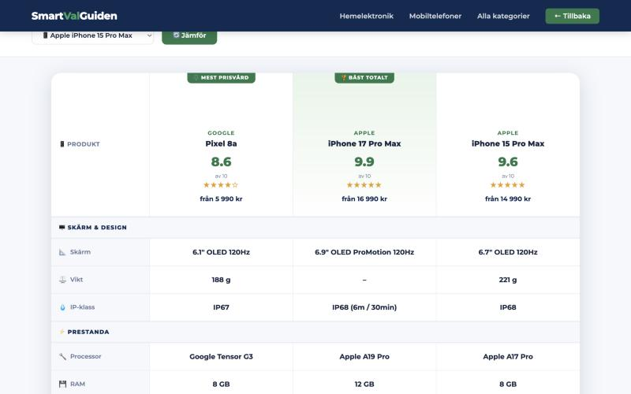
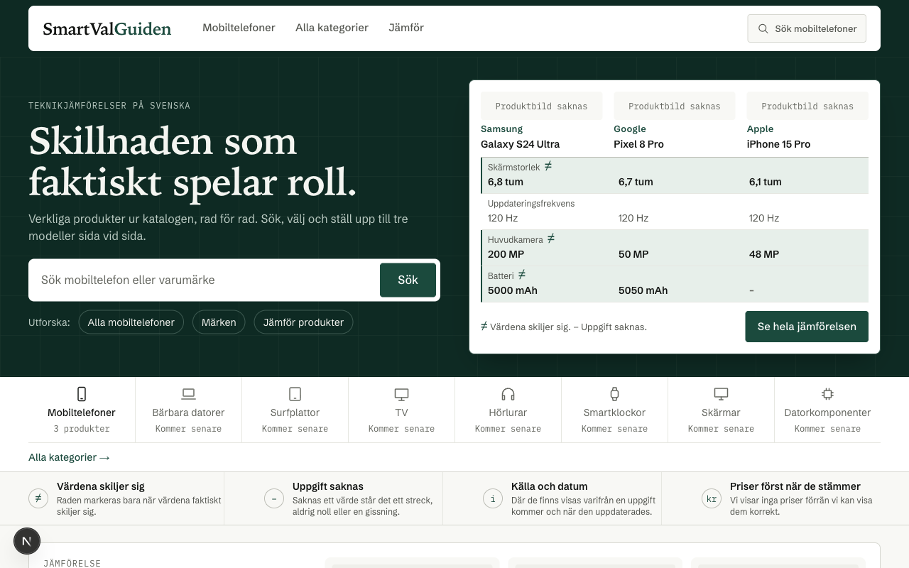
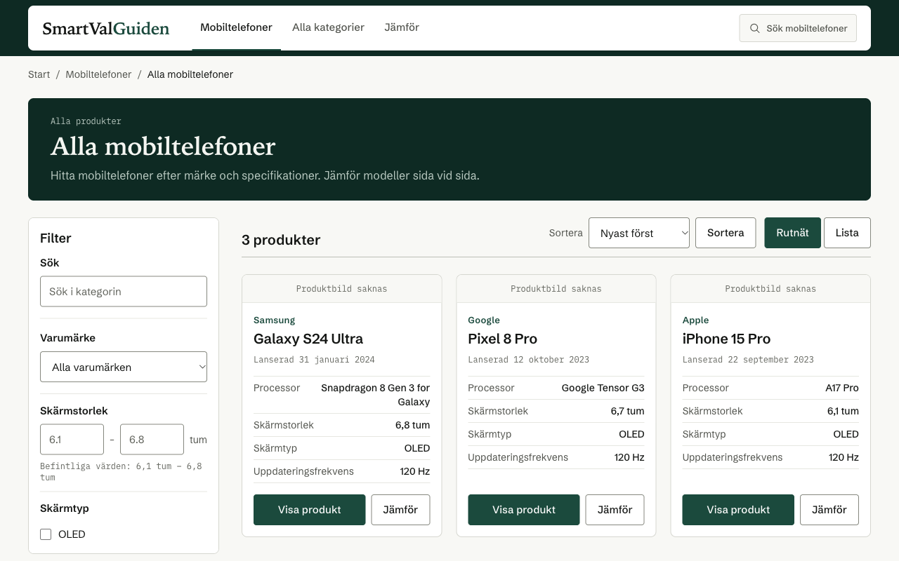
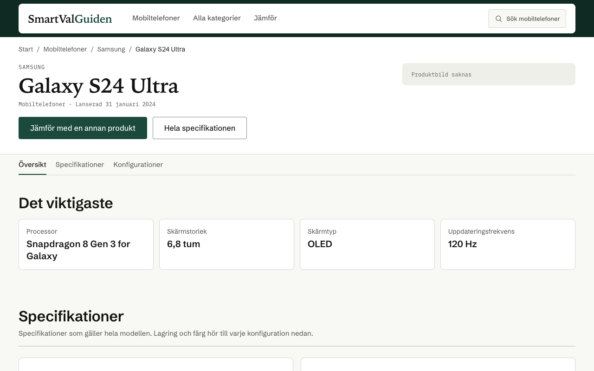
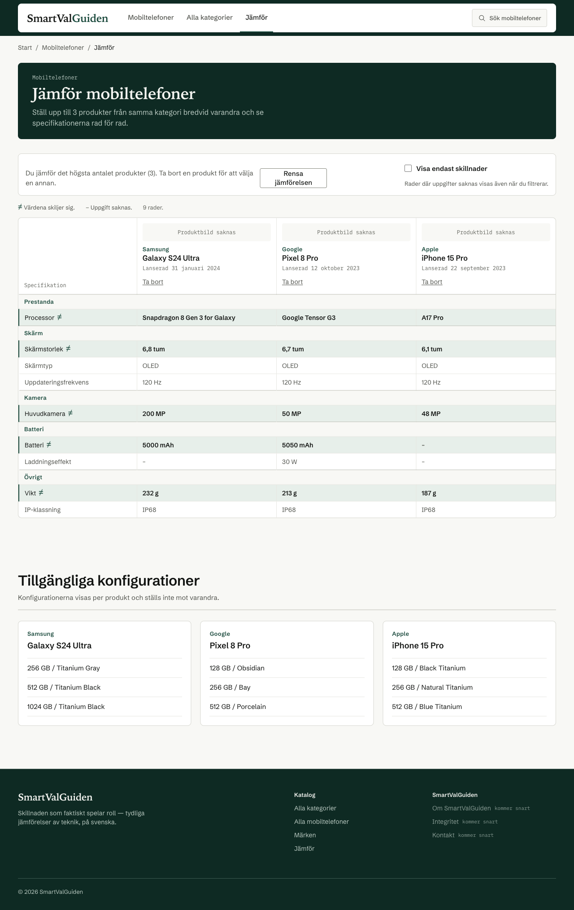
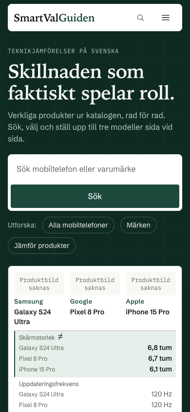

# 🛒 SmartValGuiden

### *Skillnaden som faktiskt spelar roll*

A Swedish consumer-tech guide that helps people **understand, compare and choose** electronics, starting with mobile phones.

 

 

  

 

## 📝 About the project

Most comparison sites only compare prices. **SmartValGuiden** aims to help Swedish shoppers understand what actually differs between products, so they can make a confident choice.

I started the project on my own and built the first version from scratch. I am now rebuilding it on a modern stack to make it faster, easier to extend and ready for more product categories.

> 🔒 The source code is kept in a private repository. This repository presents the project.

 

## ✨ Features

**Version 1 – live today**
- 📱 Phone catalogue with search and price filters
- ⚖️ Side-by-side comparison of up to three phones, with scores and specifications
- 🔐 Admin panel with authentication for managing content
- 🤖 AI integration to support content and buying guidance

**Version 2 – in development**
- ⚡ Rebuilt in **Next.js** and **React**
- 🗂️ Product catalogue with filters and sorting
- 📄 Dedicated product pages
- ⚖️ Compare two or three products, with the selection stored in the URL so comparisons can be shared

  
   
  Side-by-side comparison of three phones with scores, prices and specifications

 

## 👀 Version 2 preview

Screenshots of version 2 running locally (Next.js, React and Supabase). Version 2 is not live yet.

  
   
  Start page with search, category overview and a live comparison of three phones

  
   
  Phone catalogue with filters for brand, screen size and screen type, plus sorting and grid or list view

  
   
  Product page with key specifications, full specification list and available configurations

  
   
  Comparison of three phones: rows where the values differ are highlighted and missing data is shown as a dash

  
   
  Start page on mobile (390 px wide)

 

## 🔒 Security work

Before the rebuild I carried out my own security audit of version 1 and fixed:

- **Cross-site scripting (XSS)** vulnerabilities
- **Timing-unsafe token comparisons** in authentication
- **Unsafe image and input validation** in the server-side image proxy

 

## 🛠️ Tech stack

| | Version 1 | Version 2 |
|---|---|---|
| **Frontend** | HTML, CSS, JavaScript | React, Next.js |
| **Backend** | PHP | Next.js |
| **Workflow** | Git | Git, local AI models with Ollama |

 

## 🗺️ Roadmap

- [x] Version 1 live with phones
- [x] Security audit of version 1
- [ ] Launch version 2 (Next.js)
- [ ] Price history for each product
- [ ] Personalised scoring based on what matters to each user
- [ ] More categories: laptops, TVs, headphones, tablets, smartwatches and monitors

 

## 👤 Author

**Abdelrahman Hana** · Computer Engineering student at KTH Royal Institute of Technology

[GitHub](https://github.com/Abdelrahman0816) · [abduhassan930@gmail.com](mailto:abduhassan930@gmail.com)
